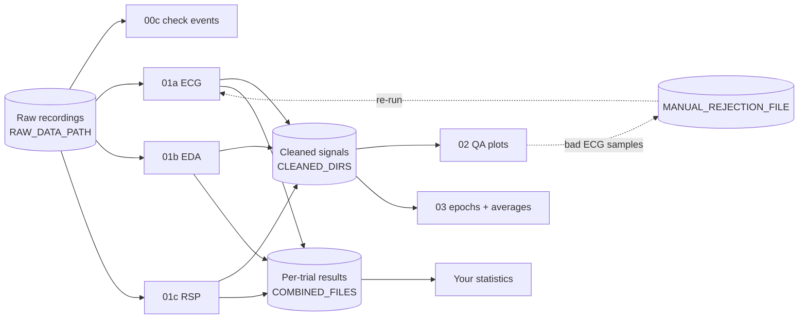

# NeuroKit2 physiology pipeline (ECG, EDA, respiration)

Template scripts for cleaning and analysing **event-related ECG, EDA and respiration (RSP)**
data with [NeuroKit2](https://neuropsychology.github.io/NeuroKit/). They were written for
BIOPAC AcqKnowledge (`.acq`) recordings with three trigger channels (Control, Down, Up). Paths
and study-specific settings live in a config file, so you can reuse the scripts for a new study
without editing the analysis code.

| Interactive QA plot: raw vs cleaned signal with event onsets and epoch ends | Group-average response per condition |
|---|---|
|  |  |

*Both images were made from the simulated example data (`python run_pipeline.py --demo`).*

---

## Contents

- [Quick start](#quick-start)
- [How the pipeline fits together](#how-the-pipeline-fits-together)
- [What each script does](#what-each-script-does)
- [Settings: `config.py` and `config_local.py`](#settings-configpy-and-config_localpy)
- [Adapting the pipeline to a new study](#adapting-the-pipeline-to-a-new-study)
- [Troubleshooting](#troubleshooting)
- [Citing](#citing)

---

## Quick start

### 1. Install

With **conda** (recommended):
```bash
conda env create -f environment.yml
conda activate neurokit-pipeline
```
or with **pip** (Python 3.10+):
```bash
pip install -r requirements.txt
```

### 2. Try it on example data (about 1 minute)

```bash
cd path/to/NeuroKit-template-pipeline
python run_pipeline.py --demo
```
This creates four simulated participants in `example_data/` and runs every step. Outputs go to
`example_data/Data/`. Open a QA plot in `example_data/Data/Physiology/QA_Plots/` in your browser
to see what you'll get with real data.

### 3. Point it at your own data

```bash
cp config_local.example.py config_local.py      # Windows: copy config_local.example.py config_local.py
```
Open `config_local.py` and set at least `PROJECT_ROOT`, the folder that contains your `Data/`
folder. Git ignores `config_local.py`, so your paths stay on your computer and
`git pull` won't overwrite them.

### 4. Check your events, then run

```bash
python 00c_check_events.py          # check events and condition labels for TEST_PARTICIPANT
python run_pipeline.py              # run everything in order
```

You can also run the scripts one at a time (`python 01a_process_ecg.py`, …). They contain
`# %%` cells, so you can step through them in VS Code or Spyder. **Run them from inside this
folder** so they can find `config.py`.

---

## How the pipeline fits together



1. **Check** (optional `00` scripts): make sure a new dataset loads and events are labelled correctly.
2. **Process** (`01a`–`01c`): clean each signal and extract event-related features for every
   participant. The three scripts are independent and can run in any order.
3. **Quality control** (`02`): look at every participant's raw and cleaned signal.
   You can list bad ECG samples in `MANUAL_REJECTION_FILE` and re-run `01a`.
4. **Visualise** (`03`): save epochs and plot group-average responses per condition.
5. **Analyse**: load the `COMBINED_FILES` CSVs into R, JASP, SPSS or similar.

---

## What each script does

| Script | Needs | What it does | Main outputs |
|---|---|---|---|
| `run_pipeline.py` | — | Runs the steps below in order. `--demo` uses example data, `--steps 02 03` runs only some steps, `--show-plots` opens figure windows. | — |
| `make_example_data.py` | — | Creates simulated recordings for 4 participants (called automatically by `--demo`). | `example_data/Data/Physiology/Raw/*.csv` |
| `00a_single_subject_ecg.py`<br>`00b_single_subject_eda.py` *(optional)* | raw data | Runs the ECG or EDA pipeline on `TEST_PARTICIPANT` with diagnostic plots. Useful for checking a new dataset. | `SINGLE_SUBJECT_OUTPUT_PATH/sub-XXX_<signal>_results.csv` |
| `00c_check_events.py` *(recommended)* | raw data | Lists every detected event with its condition label and the trigger channel that is actually active at that moment, and flags any mismatch. Also states each epoch window in plain words. Run `python 00c_check_events.py 012` to check participant 012. | printed report |
| `01a_process_ecg.py` | raw data | For each participant: load → detect events → mask manually flagged bad ECG samples (optional) → clean with `nk.bio_process` → epoch → `nk.ecg_analyze` (event-related). Saves after every participant, so you can stop and resume. | `CLEANED_DIRS["ECG"]/sub-XXX_ECG_cleaned.csv`<br>`COMBINED_FILES["ECG"]`<br>`LOG_PATH/log_ecg.txt` |
| `01b_process_eda.py` | raw data | Same as `01a` for EDA (`nk.eda_analyze`). | `CLEANED_DIRS["EDA"]/…`, `COMBINED_FILES["EDA"]`, `log_eda.txt` |
| `01c_process_rsp.py` | raw data | Same as `01a` for respiration (`nk.rsp_analyze`). | `CLEANED_DIRS["RSP"]/…`, `COMBINED_FILES["RSP"]`, `log_rsp.txt` |
| `02_qa_plots.py` | `01a`–`01c` | One interactive HTML per participant and signal: raw signal on top, cleaned signal below, with a solid line at each event onset and a dotted line where each epoch ends. | `QA_PLOTS_PATH/sub-XXX/sub-XXX_<signal>_QA_epochs.html` |
| `03_epochs_and_average_plots.py` | `01a`–`01c` | Detects events once per participant, saves events and epochs for each signal, and plots the cleaned signal averaged across trials and participants for each condition. | `EPOCHS_PATH/sub-XXX_events.pkl`<br>`EPOCHS_PATH/sub-XXX_<signal>_epochs.pkl`<br>`FIGURES_PATH/average_<signal>_by_condition.png` |
| `config.py` | — | All settings and their defaults. | — |
| `config_local.example.py` | — | Template for your personal `config_local.py`. | — |
| `utils.py` | — | Shared helpers: loading raw files, finding events, logging. | — |
| `archive/` | — | Earlier versions of the scripts, kept for reference (see [Archive](#archive)). | — |

### Results files

Each `COMBINED_FILES` CSV has **one row per participant × trial** with these columns:

- `participant_id`, e.g. `sub-012`
- `Trial`
- `Condition` (`Control` / `Down` / `Up`)
- the NeuroKit event-related features, e.g. `ECG_Rate_Mean`, `EDA_Peak_Amplitude`, `RSP_Rate_Mean`

See the NeuroKit documentation for
[`ecg_eventrelated`](https://neuropsychology.github.io/NeuroKit/functions/ecg.html#ecg-eventrelated),
[`eda_eventrelated`](https://neuropsychology.github.io/NeuroKit/functions/eda.html#eda-eventrelated) and
[`rsp_eventrelated`](https://neuropsychology.github.io/NeuroKit/functions/rsp.html#rsp-eventrelated)
for what each feature means.

### Masking bad ECG segments (optional)

After checking the QA plots, list bad ECG samples in a CSV at `MANUAL_REJECTION_FILE`:

```csv
participant,signal,onset_sample
sub-012,ECG,153200
sub-012,ECG,201450
sub-031,ECG,NA
```

Then set `ECG_BAD_WINDOW_SEC` (e.g. `1`) and `RERUN_PROCESSED_PARTICIPANTS = True` in
`config_local.py`, and re-run `01a`.

- Each listed sample is masked ± `ECG_BAD_WINDOW_SEC` seconds. **With the default of 0, nothing is masked.**
- NeuroKit *interpolates* across masked samples when cleaning; it does not drop them.
- `NA` marks a participant's whole ECG as unusable, so they are skipped.
- If the file doesn't exist, masking is skipped.

---

## Settings: `config.py` and `config_local.py`

`config.py` holds **every setting with a sensible default**. Your own values go in
**`config_local.py`**, which only needs the settings you want to change:

```python
# config_local.py
PROJECT_ROOT = "/Users/me/Documents/MyStudy"
EXCLUDED_PARTICIPANTS = {"003", "017"}
TEST_PARTICIPANT = "005"
```

If you misspell a setting name in `config_local.py`, you'll get a warning when the scripts run.

| Group | Setting | What it controls |
|---|---|---|
| **Paths** | `PROJECT_ROOT` | **Required.** Top-level project folder; the default paths are built from it. You can also set it with the environment variable `NK_PROJECT_ROOT`. |
| | `DATA_PATH` | Parent data folder (default `PROJECT_ROOT/Data`). |
| | `RAW_DATA_PATH` | Folder with one raw file per participant (default `DATA_PATH/Physiology/Raw`). |
| | `MANUAL_REJECTION_FILE` | Optional bad-ECG list (see above). `None` disables masking. |
| | `OUTPUT_PATH` | Parent folder for all outputs (default `DATA_PATH`). |
| | `COMBINED_PATH`, `CLEANED_PATH`, `EPOCHS_PATH`, `QA_PLOTS_PATH`, `FIGURES_PATH`, `LOG_PATH`, `SINGLE_SUBJECT_OUTPUT_PATH` | Where each type of output goes. Folders are created automatically. |
| | `COMBINED_FILES` | Filename of each signal's results CSV. |
| **Data format** | `RAW_FILE_EXTENSION` | `.acq` (default) or `.csv`. |
| | `PARTICIPANT_ID_LENGTH` | Participant ID = first N characters of the filename (`012_filtered_chopped.acq` → `012`). |
| | `CHANNEL_RENAME` | Maps your raw channel names to `ECG`, `EDA`, `RSP`. |
| | `EVENT_COLUMNS` | Names of the trigger channels. **The order sets the condition codes** (see below). |
| | `CONDITION_LABELS` | Built automatically from `EVENT_COLUMNS`. |
| | `SAMPLING_RATE` | Used for `.csv` raw files and for re-loading cleaned files. `.acq` files report their own rate. |
| **Participants** | `EXCLUDED_PARTICIPANTS` | IDs that are always skipped, e.g. `{"001", "084"}`. |
| | `RERUN_PROCESSED_PARTICIPANTS` | `False` = resume (skip anyone already in the results CSV). `True` = re-process everyone and replace their rows. |
| | `TEST_PARTICIPANT` | Participant used by the `00` scripts. |
| **Analysis** | `EPOCH_WINDOWS` | Epoch start and end in seconds relative to event onset, for each signal. Negative means *before* onset. Steps `01`, `02` and `03` all use these values. |
| | `ECG_BAD_WINDOW_SEC` | Masking window for bad ECG samples. |
| | `DOWNSAMPLE_FACTOR` | Downsampling for QA plots only (keeps the HTML files small). |
| | `FORCE_RECREATE_EVENTS` | Re-detect events in `03` even if saved ones exist. |

**How conditions are numbered.** When `nk.events_find` is given several trigger channels, it
codes each event by the channel's *position* in `EVENT_COLUMNS` as a power of two
(1st → 1, 2nd → 2, 3rd → 4). With the default order (`ControlEvent`, `DownEvent`, `UpEvent`)
this gives Control = 1, Down = 2, Up = 4. `CONDITION_LABELS` is built from the same list, so the
labels stay correct if you reorder or rename the channels. `00c_check_events.py` confirms this
against your data.

### Default folder layout

```
PROJECT_ROOT/
└── Data/                                   ← DATA_PATH and OUTPUT_PATH
    ├── manual_epoch_rejection.csv          ← MANUAL_REJECTION_FILE (optional)
    ├── Physiology/
    │   ├── Raw/                            ← RAW_DATA_PATH  (input)
    │   ├── NeuroKit_Cleaned/{ECG,EDA,RSP}/ ← CLEANED_DIRS
    │   ├── Events/                         ← EPOCHS_PATH
    │   └── QA_Plots/                       ← QA_PLOTS_PATH
    ├── Combined/                           ← COMBINED_FILES
    ├── Figures/                            ← FIGURES_PATH
    ├── Processing/                         ← LOG_PATH
    └── Single_Subject/                     ← SINGLE_SUBJECT_OUTPUT_PATH
```

---

## Adapting the pipeline to a new study

1. **Different channel or trigger names**: set `CHANNEL_RENAME` and `EVENT_COLUMNS` in
   `config_local.py`, then run `00c_check_events.py`.
2. **Different epoch lengths**: set `EPOCH_WINDOWS`.
3. **CSV exports instead of `.acq`**: set `RAW_FILE_EXTENSION = ".csv"` and `SAMPLING_RATE`.
   Each CSV needs one column per channel, named as in `CHANNEL_RENAME`.
4. **Another file format**: add an `elif` for it in `utils.load_raw_data()`. No other code reads raw files.
5. **PPG instead of ECG**: copy `01a_process_ecg.py` and swap `ecg=` / `nk.ecg_analyze` for
   `ppg=` / `nk.ppg_analyze`.

---

## Troubleshooting

| Problem | Fix |
|---|---|
| `RuntimeError: PROJECT_ROOT is not set` | Create `config_local.py` (see [Quick start](#3-point-it-at-your-own-data)), or try `python run_pipeline.py --demo`. |
| `ModuleNotFoundError: No module named 'config'` | Run the scripts from inside the repository folder (`cd NeuroKit-template-pipeline`). |
| `RAW_DATA_PATH does not exist` | Check `PROJECT_ROOT` / `RAW_DATA_PATH` in `config_local.py`. |
| A participant is listed as `skipped: error during processing` | See `LOG_PATH/log_<signal>.txt` for the error message. The other participants still run. |
| Nothing happens for participants you already ran | That's resume mode. Set `RERUN_PROCESSED_PARTICIPANTS = True` to re-process them. |
| NeuroKit warns *"The duration of your epochs seems quite long"* for EDA | NeuroKit shows this for EDA epochs over 10 s. The 12 s window is deliberate, because skin conductance responses are slow. Change `EPOCH_WINDOWS["EDA"]` if that doesn't fit your design. |
| A script seems to hang after making a figure | A figure window is open. Close it, or use `run_pipeline.py`, which saves figures without opening windows. |
| `00c_check_events.py` reports mismatched events | Usually two trigger channels are active at the same time, or `CONDITION_LABELS` was overridden by hand. |

---

## Citing

If you use this pipeline in a paper, please cite NeuroKit2:

> Makowski, D., Pham, T., Lau, Z. J., Brammer, J. C., Lespinasse, F., Pham, H., Schölzel, C., &
> Chen, S. H. A. (2021). NeuroKit2: A Python toolbox for neurophysiological signal processing.
> *Behavior Research Methods, 53*(4), 1689–1696. https://doi.org/10.3758/s13428-020-01516-y

```bibtex
@article{Makowski2021neurokit,
  author    = {Dominique Makowski and Tam Pham and Zen J. Lau and Jan C. Brammer and
               Fran{\c{c}}ois Lespinasse and Hung Pham and Christopher Schölzel and
               S. H. Annabel Chen},
  title     = {{NeuroKit}2: A Python toolbox for neurophysiological signal processing},
  journal   = {Behavior Research Methods},
  volume    = {53},
  number    = {4},
  pages     = {1689--1696},
  year      = {2021},
  doi       = {10.3758/s13428-020-01516-y}
}
```

Please also report the NeuroKit2 version you used (`python -c "import neurokit2; print(neurokit2.__version__)"`)
and the key settings from `config.py` (epoch windows and any masking) in your methods.

---

## Archive

`archive/` holds earlier versions of the scripts, kept so older outputs can be traced back.
Their paths come from `config.py`, but they are **not** part of the pipeline.

| File | Replaced by | Notes |
|---|---|---|
| `all_subjects_all_physiology.py` | `01a`, `01b` | Merges ECG and EDA tables on `participant_id` only, which pairs every ECG trial with every EDA trial. Don't use it. |
| `all_subjects_ecg.py` | `01a` | Older ECG script without logging or masking. |
| `all_subjects_eda.py` | `01b` | Older EDA script. |
| `all_subjects_ecg_neurokit_manualclean_Mask.py` | `01a` | A code fragment that doesn't run on its own. Its masking logic is now in `01a`. |
| `plot_clean_data.py` | `02` | QA plots without event markers. |
| `plot_clean_data_with_events.py` | `02` | QA plots with event ticks only. |

The archived scripts that label conditions use the old mapping (`{1: Control, 2: Up, 4: Down}`),
which swaps Up and Down.

---

## License

MIT. See [LICENSE](LICENSE).
