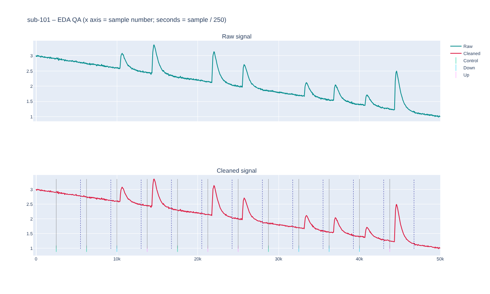
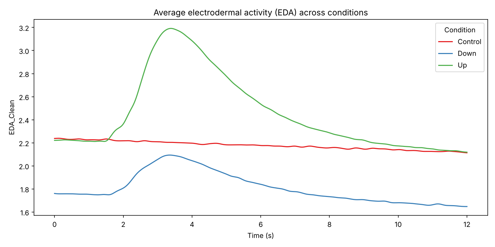

# NeuroKit2 physiology pipeline (ECG, EDA, respiration)

Template scripts for cleaning and analysing **event-related ECG, EDA and respiration (RSP)**
data with [NeuroKit2](https://neuropsychology.github.io/NeuroKit/). Paths and study-specific
settings live in a config file, so you can reuse the scripts for a new study without editing the
analysis code. You can use:

- any number of trigger channels, with your own channel names and condition labels
- **fixed-length epochs** from each trigger onset, or epochs that last as long as the trigger
  channel stays on, for blocks of different lengths
- BIOPAC AcqKnowledge (`.acq`) or CSV recordings

The defaults match the lab's original setup: three trigger channels (Control, Down, Up) and
fixed-length epochs.

> **New to Python or the command line?** Follow **[GETTING_STARTED.md](GETTING_STARTED.md)**, a
> step-by-step guide from installation to results.

| Interactive QA plot: raw vs cleaned signal with event onsets and epoch ends | Group-average EDA response per condition |
|---|---|
|  |  |

*Both images were made from the simulated example data (`python run_pipeline.py --demo`).*

---

## Contents

- [Quick start](#quick-start)
- [What each script does](#what-each-script-does)
- [Running from Box](#running-from-box)
- [Settings: `config.py` and `config_local.py`](#settings-configpy-and-config_localpy)
- [Adapting the pipeline to a new study](#adapting-the-pipeline-to-a-new-study)
- [Troubleshooting](#troubleshooting)
- [Citing](#citing)

---

## Quick start

### 1. Install

With **conda** (recommended):
```bash
conda env create -f environment.yml
conda activate neurokit-pipeline
```
or with **pip** (Python 3.10+):
```bash
pip install -r requirements.txt
```

### 2. Try it on example data (about 1 minute)

```bash
cd path/to/NeuroKit-template-pipeline
python run_pipeline.py --demo
```
This creates four simulated participants in `example_data/` and runs every step. Outputs go to
`example_data/Data/`. Open a QA plot in `example_data/Data/Figures/QA_Plots/` in your browser
to see what you'll get with real data.

### 3. Point it at your own data

```bash
cp config_local.example.py config_local.py      # Windows: copy config_local.example.py config_local.py
```
Open `config_local.py` and set at least `PROJECT_ROOT`, the folder that contains your `Data/`
folder. This is usually your study folder in Box (see [Running from Box](#running-from-box)). Git ignores `config_local.py`, so your paths stay on your computer and
`git pull` won't overwrite them.

### 4. Check your events, then run

```bash
python 00c_check_events.py          # check events and condition labels for TEST_PARTICIPANT
python run_pipeline.py              # run everything in order
```

You can also run the scripts one at a time (`python 01a_process_ecg.py`, …). They contain
`# %%` cells, so you can step through them in VS Code or Spyder. **Run them from inside this
folder** so they can find `config.py`.

---

## What each script does

| Script | Needs | What it does | Main outputs |
|---|---|---|---|
| `run_pipeline.py` | — | Runs the steps below in order. `--demo` uses example data, `--steps 02 03` runs only some steps, `--show-plots` opens figure windows. | — |
| `make_example_data.py` | — | Creates simulated recordings for 4 participants (called automatically by `--demo`). | `example_data/Data/Physiology/Raw/*.csv` |
| `00a_single_subject_ecg.py`<br>`00b_single_subject_eda.py` *(optional)* | raw data | Runs the ECG or EDA pipeline on `TEST_PARTICIPANT` with diagnostic plots. Useful for checking a new dataset. | `SINGLE_SUBJECT_OUTPUT_PATH/sub-XXX_<signal>_results.csv` |
| `00c_check_events.py` *(recommended)* | raw data | Lists every detected event with its time, how long its trigger channel stayed on, and its condition. It flags events that overlap another trigger channel, summarises trials and durations per condition, and states each signal's epoch in plain words. Run `python 00c_check_events.py 012` to check participant 012. | printed report |
| `01a_process_ecg.py` | raw data | For each participant: load → mask manually flagged bad samples (optional) → detect events → clean with `nk.bio_process` → epoch → `nk.ecg_analyze` (event-related) → **HRV** (see [Heart rate variability](#heart-rate-variability-hrv)). Saves after every participant, so you can stop and resume. | `CLEANED_DIRS["ECG"]/sub-XXX_ECG_cleaned.csv`<br>`COMBINED_FILES["ECG"]`<br>`HRV_FILE`<br>`LOG_PATH/log_ecg.txt` |
| `01b_process_eda.py` | raw data | Same as `01a` for EDA (`nk.eda_analyze`). | `CLEANED_DIRS["EDA"]/…`, `COMBINED_FILES["EDA"]`, `log_eda.txt` |
| `01c_process_rsp.py` | raw data | Same as `01a` for respiration (`nk.rsp_analyze`). | `CLEANED_DIRS["RSP"]/…`, `COMBINED_FILES["RSP"]`, `log_rsp.txt` |
| `02_qa_plots.py` | `01a`–`01c` | One interactive HTML per participant and signal: raw signal on top, cleaned signal below, with a solid line at each event onset and a dotted line where each epoch ends. | `QA_PLOTS_PATH/sub-XXX/sub-XXX_<signal>_QA_epochs.html` |
| `03_epochs_and_average_plots.py` | `01a`–`01c` | Detects events once per participant, saves events and epochs for each signal, and plots the cleaned **EDA** signal averaged across trials and participants for each condition. | `EPOCHS_PATH/sub-XXX_events.pkl`<br>`EPOCHS_PATH/sub-XXX_<signal>_epochs.pkl`<br>`FIGURES_PATH/average_EDA_by_condition.png` |
| `config.py` | — | All settings and their defaults. | — |
| `config_local.example.py` | — | Template for your personal `config_local.py`. | — |
| `utils.py` | — | Shared helpers: loading raw files, finding events, logging. | — |

### Results files

Each `COMBINED_FILES` CSV has **one row per participant × trial** with these columns:

- `participant_id`, e.g. `sub-012`
- `Trial`
- `Condition` (the labels from `EVENT_CHANNELS`)
- the NeuroKit event-related features, e.g. `ECG_Rate_Mean`, `EDA_Peak_Amplitude`, `RSP_Rate_Mean`

See the NeuroKit documentation for
[`ecg_eventrelated`](https://neuropsychology.github.io/NeuroKit/functions/ecg.html#ecg-eventrelated),
[`eda_eventrelated`](https://neuropsychology.github.io/NeuroKit/functions/eda.html#eda-eventrelated) and
[`rsp_eventrelated`](https://neuropsychology.github.io/NeuroKit/functions/rsp.html#rsp-eventrelated)
for what each feature means.

### Heart rate variability (HRV)

`01a_process_ecg.py` computes HRV in two ways:

| | Where it's saved | What you get | When it's computed |
|---|---|---|---|
| **Whole recording** | `HRV_FILE` (`hrv_results_combined.csv`), one row per participant | Time-domain (e.g. `HRV_RMSSD`, `HRV_SDNN`), frequency-domain (e.g. `HRV_HF`, `HRV_LF`) and non-linear indices, plus `HRV_N_Beats` and `HRV_Duration_s` | Always, unless `HRV_WHOLE_RECORDING = False`. Set `HRV_SEGMENT_SEC = (0, 300)` to use only part of the recording, e.g. a 5-minute resting baseline. |
| **Per epoch** | Extra `HRV_*` columns in the ECG results, one value per trial or block | Time-domain indices only (e.g. `HRV_RMSSD`, `HRV_SDNN`, `HRV_MeanNN`) | Only for epochs at least `HRV_MIN_EPOCH_SEC` long (default 30 s). Shorter epochs get empty cells, or no HRV columns at all if every epoch is short. |

- **Short epochs.** HRV needs many heartbeats. With short trial-based epochs (e.g. 6 s), use
  the whole-recording or baseline HRV. Per-epoch HRV is meant for blocks, e.g. with
  `EVENT_DURATION_MODE = "channel"`.
- **R-peak correction.** Before computing HRV, R-peaks are re-detected with NeuroKit's artifact
  correction, which fixes missed and extra beats (`HRV_CORRECT_ARTIFACTS = True`). HRV is still
  sensitive to noisy ECG, so check the QA plots.
- **Masked segments.** Masked ECG becomes a flat line, which can hide or merge beats. HRV from
  heavily masked recordings is unreliable.
- **Index definitions.** See NeuroKit's [`hrv`](https://neuropsychology.github.io/NeuroKit/functions/hrv.html)
  documentation for what each index means.

### Masking bad segments (optional, any signal)

After checking the QA plots, list bad samples in a CSV at `MANUAL_REJECTION_FILE`
(default `Data/manual_epoch_rejection.csv`). It works for ECG, EDA and RSP:

```csv
participant,signal,onset_sample
sub-012,ECG,153200
sub-012,EDA,201450
sub-017,RSP,88000
sub-031,ECG,NA
```

- `onset_sample` is the sample number at the centre of the bad stretch. Hover over the QA plot to
  read it from the x axis.
- `NA` marks that participant's whole signal as unusable, so they're skipped for that signal only.

Then set the masking window in `config_local.py` and re-run the `01` scripts with
`RERUN_PROCESSED_PARTICIPANTS = True`:

```python
MASK_WINDOW_SEC = 1                                  # same for all signals, or
MASK_WINDOW_SEC = {"ECG": 1, "EDA": 2, "RSP": 2}     # per signal
```

- Each listed sample is masked ± `MASK_WINDOW_SEC` seconds. **With the default of 0, nothing is masked**
  (only `NA` rows have an effect).
- **What masking does.** NeuroKit's cleaning fills masked samples with the last good value, so a
  masked stretch becomes a flat line. It removes a spike or artefact from the signal but doesn't
  drop the trial. Features from epochs that overlap a masked stretch are computed partly from
  that flat segment, so check those trials or exclude them in your statistics.
- If the file doesn't exist, masking is skipped.

---

## Running from Box

The department stores data in Box. With **Box Drive** you can run the pipeline directly on
your study folder in Box, so you never need to copy large raw data files to your computer.

1. **Install Box Drive** from your university's software page or [box.com](https://www.box.com/drive),
   and sign in with your university account. Your Box files then appear as a folder on your computer:
   - **Mac:** `~/Library/CloudStorage/Box-Box/` (also shown as **Box** under *Locations* in the Finder sidebar)
   - **Windows:** `C:/Users/<your name>/Box/`
2. **Point `PROJECT_ROOT` at your study folder in Box** in `config_local.py`:
   ```python
   PROJECT_ROOT = "~/Library/CloudStorage/Box-Box/MyLab/MyStudy"     # Mac
   PROJECT_ROOT = "C:/Users/yourname/Box/MyLab/MyStudy"              # Windows
   ```
   `~` means your home folder. Easiest way to get the exact path: in Finder, right-click the
   study folder, hold **Option** and choose **Copy as Pathname** (Windows: Shift + right-click →
   **Copy as path**, then change `\` to `/`).
3. **Run the pipeline as usual.** Box Drive downloads each raw file only when the pipeline opens it.
   Results, cleaned signals and figures are written straight into the study folder in Box, so they
   upload automatically and the rest of the lab can see them.

**Things to know**

- **Only the data go in Box.** Keep the pipeline code (this repository) on your computer, e.g. in
  `Documents/GitHub`. Your `config_local.py` stays with the code.
- **You need an internet connection.** The first run is slower because each raw file is
  downloaded. Box Drive keeps opened files in a local cache, so re-runs are faster. You can clear
  the cache in Box Drive's preferences if disk space is tight.
- **Don't run the same study at the same time as a colleague.** Two people writing to the same results
  files in Box at once can create conflicting copies. Agree who runs it, or give each person their
  own outputs folder with `OUTPUT_PATH = "~/Library/CloudStorage/Box-Box/MyLab/MyStudy/Data/Outputs_Jo"`.
- **Don't open results files during a run.** If a results CSV is open in Excel while the pipeline
  runs, saving can fail. Close it and run again. Participants already done are skipped.
- **Separate raw data and outputs if you like.** For example, read raw data from a shared Box folder
  but save outputs to your own: set `RAW_DATA_PATH` and `OUTPUT_PATH` separately in `config_local.py`.

---

## Settings: `config.py` and `config_local.py`

`config.py` holds **every setting with a sensible default**. Your own values go in
**`config_local.py`**, which only needs the settings you want to change:

```python
# config_local.py
PROJECT_ROOT = "~/Library/CloudStorage/Box-Box/MyLab/MyStudy"
EXCLUDED_PARTICIPANTS = {"003", "017"}
TEST_PARTICIPANT = "005"
```

If you misspell a setting name in `config_local.py`, you'll get a warning when the scripts run.

| Group | Setting | What it controls |
|---|---|---|
| **Paths** | `PROJECT_ROOT` | **Required.** Top-level project folder, usually your study folder in Box Drive; the default paths are built from it. `~` (home folder) is allowed. You can also set it with the environment variable `NK_PROJECT_ROOT`. |
| | `DATA_PATH` | Parent data folder (default `PROJECT_ROOT/Data`). |
| | `RAW_DATA_PATH` | Folder with one raw file per participant (default `DATA_PATH/Physiology/Raw`). |
| | `MANUAL_REJECTION_FILE` | Optional list of bad samples for any signal (see [Masking](#masking-bad-segments-optional-any-signal)). `None` disables masking. |
| | `OUTPUT_PATH` | Parent folder for all outputs (default `DATA_PATH`). |
| | `COMBINED_PATH`, `CLEANED_PATH`, `EPOCHS_PATH`, `QA_PLOTS_PATH`, `FIGURES_PATH`, `LOG_PATH`, `SINGLE_SUBJECT_OUTPUT_PATH` | Where each type of output goes. Folders are created automatically. |
| | `COMBINED_FILES` | Filename of each signal's results CSV. |
| | `HRV_FILE` | Filename of the whole-recording HRV results. |
| **Data format** | `RAW_FILE_EXTENSION` | `.acq` (default) or `.csv`. |
| | `PARTICIPANT_ID_LENGTH` | Participant ID = first N characters of the filename (`012_filtered_chopped.acq` → `012`). |
| | `CHANNEL_RENAME` | Maps your raw channel names to `ECG`, `EDA`, `RSP`. |
| **Events** | `EVENT_CHANNELS` | Your trigger channels and the condition label for each: `{channel name: label}`. Use any number of channels. See [Setting up events](#setting-up-events). |
| | `EVENT_THRESHOLD` | A trigger channel counts as *on* while its value is above this (default `0.001`). |
| | `EVENT_MIN_DURATION_SEC` | Ignore events shorter than this, e.g. trigger glitches (default `0`, keep all). |
| | `EVENT_DURATION_MODE` | `"fixed"` (every epoch the same length) or `"channel"` (each epoch lasts as long as its trigger channel stays on). |
| | `SAMPLING_RATE` | Used for `.csv` raw files and for re-loading cleaned files. `.acq` files report their own rate. |
| **Participants** | `EXCLUDED_PARTICIPANTS` | IDs that are always skipped, e.g. `{"001", "084"}`. |
| | `RERUN_PROCESSED_PARTICIPANTS` | `False` = resume (skip anyone already in the results CSV). `True` = re-process everyone and replace their rows. |
| | `TEST_PARTICIPANT` | Participant used by the `00` scripts. |
| **Analysis** | `EPOCH_WINDOWS` | Epoch `start` and `end` in seconds for each signal. `start` is relative to the event onset (negative = before). What `end` means depends on `EVENT_DURATION_MODE`. Steps `01`, `02` and `03` all use these values. |
| | `MASK_WINDOW_SEC` | Seconds masked either side of each bad sample: one number, or a dict per signal. |
| **HRV** | `HRV_WHOLE_RECORDING` | Compute HRV for each participant's whole recording (default `True`). |
| | `HRV_SEGMENT_SEC` | `None` (whole recording) or `(start, end)` in seconds, e.g. `(0, 300)`. |
| | `HRV_INDICES` | Which index groups to compute for the whole recording: any of `"time"`, `"frequency"`, `"nonlinear"`. |
| | `HRV_PER_EPOCH` | Add time-domain HRV to each long-enough epoch (default `True`). |
| | `HRV_MIN_EPOCH_SEC` | Minimum epoch length for per-epoch HRV (default `30`). |
| | `HRV_CORRECT_ARTIFACTS` | Correct R-peak artifacts before computing HRV (default `True`). |
| | `DOWNSAMPLE_FACTOR` | Downsampling for QA plots only (keeps the HTML files small). |
| | `FORCE_RECREATE_EVENTS` | Re-detect events in `03` even if saved ones exist. |

### Setting up events

**1. Name your trigger channels and conditions.** List every trigger channel in your
recordings with the condition label it stands for. Each time a channel switches on counts as
one event (trial) of that condition. You can use one channel or many:

```python
# one trigger channel
EVENT_CHANNELS = {"Stimulus": "Stimulus"}

# three channels (the default)
EVENT_CHANNELS = {"ControlEvent": "Control", "DownEvent": "Down", "UpEvent": "Up"}

# four channels with your own labels
EVENT_CHANNELS = {"Ch1": "Rest", "Ch2": "Low load", "Ch3": "High load", "Ch4": "Recovery"}
```

The channel names must match the column names in your data (after `CHANNEL_RENAME`). The labels
appear in the `Condition` column of your results.

Events are detected with NeuroKit's `nk.events_find()`, one channel at a time: an event starts
when the channel rises above `EVENT_THRESHOLD` and ends when it drops back below it. The events
from all channels are then combined in time order with `nk.events_create()`. To ignore very short
trigger glitches, set `EVENT_MIN_DURATION_SEC`, e.g. `0.005`.

**2. Choose how long each event lasts** with `EVENT_DURATION_MODE`:

| Mode | Use it when | Epoch runs from | Epoch runs until |
|---|---|---|---|
| `"fixed"` (default) | The trigger marks the **onset** and the event length is set by your task (e.g. a 100 ms pulse at the start of every 6 s trial). How long the trigger channel stays on is ignored. | onset + `start` | onset + `end` |
| `"channel"` | The trigger channel stays on for the **whole** trial or block, so its onset *and* offset mark the event, and events can differ in length. | onset + `start` | the moment the channel switches off + `end` |

Examples:

```python
# Fixed: 1 s baseline before each trigger, then 10 s after it
EVENT_DURATION_MODE = "fixed"
EPOCH_WINDOWS = {"ECG": {"start": -1, "end": 10},
                 "EDA": {"start": -1, "end": 10},
                 "RSP": {"start": -1, "end": 10}}

# Channel: each block from 2 s before it starts until it ends (EDA: plus 5 s, as EDA responds slowly)
EVENT_DURATION_MODE = "channel"
EPOCH_WINDOWS = {"ECG": {"start": -2, "end": 0},
                 "EDA": {"start": -2, "end": 5},
                 "RSP": {"start": -2, "end": 0}}
```

`00c_check_events.py` shows how long each channel stays on, so you can tell which mode fits. It
also prints the resulting epoch lengths.

> For long blocks (minutes rather than seconds), NeuroKit may warn that the epochs "seem quite long"
> and suggest *interval-related* analysis. Event-related features still work, but for
> block designs see NeuroKit's `*_intervalrelated` functions.

### Default folder layout

```
PROJECT_ROOT/
└── Data/                                   ← DATA_PATH and OUTPUT_PATH
    ├── manual_epoch_rejection.csv          ← MANUAL_REJECTION_FILE (optional)
    ├── Physiology/
    │   ├── Raw/                            ← RAW_DATA_PATH  (input)
    │   ├── NeuroKit_Cleaned/{ECG,EDA,RSP}/ ← CLEANED_DIRS
    │   └── Events/                         ← EPOCHS_PATH
    ├── Combined/                           ← COMBINED_FILES and HRV_FILE (your results)
    ├── Figures/                            ← FIGURES_PATH (group-average EDA plot)
    │   └── QA_Plots/                       ← QA_PLOTS_PATH (one subfolder per participant)
    ├── Processing/                         ← LOG_PATH
    └── Single_Subject/                     ← SINGLE_SUBJECT_OUTPUT_PATH
```

---

## Adapting the pipeline to a new study

1. **Different trigger channels or conditions**: set `EVENT_CHANNELS` (and, if your signal
   channels have other names, `CHANNEL_RENAME`) in `config_local.py`, then run `00c_check_events.py`.
2. **Different epoch lengths, or blocks instead of short triggers**: set `EPOCH_WINDOWS` and
   `EVENT_DURATION_MODE` (see [Setting up events](#setting-up-events)).
3. **CSV exports instead of `.acq`**: set `RAW_FILE_EXTENSION = ".csv"` and `SAMPLING_RATE`.
   Each CSV needs one column per channel, named as in `CHANNEL_RENAME`.
4. **Another file format**: add an `elif` for it in `utils.load_raw_data()`. No other code reads raw files.
5. **PPG instead of ECG**: copy `01a_process_ecg.py` and swap `ecg=` / `nk.ecg_analyze` for
   `ppg=` / `nk.ppg_analyze`.

---

## Troubleshooting

| Problem | Fix |
|---|---|
| `RuntimeError: PROJECT_ROOT is not set` | Create `config_local.py` (see [Quick start](#3-point-it-at-your-own-data)), or try `python run_pipeline.py --demo`. |
| `ModuleNotFoundError: No module named 'config'` | Run the scripts from inside the repository folder (`cd NeuroKit-template-pipeline`). |
| `RAW_DATA_PATH does not exist` | Check `PROJECT_ROOT` / `RAW_DATA_PATH` in `config_local.py`. If it's a Box path, check that Box Drive is running and signed in. |
| Very slow first run from Box | Normal: Box Drive is downloading each raw file. Re-runs use the cache. |
| A participant is listed as `skipped: error during processing` | See `LOG_PATH/log_<signal>.txt` for the error message. The other participants still run. |
| Nothing happens for participants you already ran | That's resume mode. Set `RERUN_PROCESSED_PARTICIPANTS = True` to re-process them. |
| NeuroKit warns *"The duration of your epochs seems quite long"* for EDA | NeuroKit shows this for EDA epochs over 10 s. The 12 s window is deliberate, because skin conductance responses are slow. Change `EPOCH_WINDOWS["EDA"]` if that doesn't fit your design. |
| A script seems to hang after making a figure | A figure window is open. Close it, or use `run_pipeline.py`, which saves figures without opening windows. |
| `00c_check_events.py` reports events that OVERLAP another channel | Two trigger channels were on at the same time. If your design doesn't do this, look at those trigger channels in the raw file. Short glitches show up as events lasting only a few milliseconds. |
| `00c_check_events.py` finds no events, or far too many | Check `EVENT_CHANNELS` names and `EVENT_THRESHOLD`. The script prints each channel's maximum value to help you choose a threshold. |

---

## Citing

This pipeline is built on **NeuroKit2**. If you publish results produced with it, cite NeuroKit2:

> Makowski, D., Pham, T., Lau, Z. J., Brammer, J. C., Lespinasse, F., Pham, H., Schölzel, C., &
> Chen, S. H. A. (2021). NeuroKit2: A Python toolbox for neurophysiological signal processing.
> *Behavior Research Methods, 53*(4), 1689–1696. https://doi.org/10.3758/s13428-020-01516-y

```bibtex
@article{Makowski2021neurokit,
  author    = {Dominique Makowski and Tam Pham and Zen J. Lau and Jan C. Brammer and
               Fran{\c{c}}ois Lespinasse and Hung Pham and Christopher Schölzel and
               S. H. Annabel Chen},
  title     = {{NeuroKit}2: A Python toolbox for neurophysiological signal processing},
  journal   = {Behavior Research Methods},
  volume    = {53},
  number    = {4},
  pages     = {1689--1696},
  year      = {2021},
  doi       = {10.3758/s13428-020-01516-y}
}
```

Please also report the NeuroKit2 version you used (`python -c "import neurokit2; print(neurokit2.__version__)"`)
and the key settings from `config.py` (event duration mode, epoch windows, HRV settings and any masking) in your methods.

---

## License

MIT. See [LICENSE](LICENSE).
